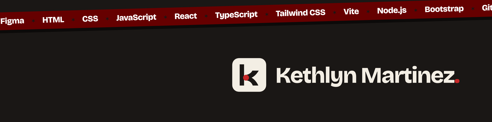

## Olá, eu sou a Kethlyn

Trabalho com pesquisa de usuários, design de interfaces e desenvolvimento front-end. Pesquisa, design e front-end são três trajetórias que se encontram e se entrelaçam na minha carreira. Eu sou o ponto em que elas convergem.

Sou designer desde 2017 e fui a primeira UX researcher da Aprenda Mais, plataforma de cursos on-line do MEC. Moro em Porto Alegre, RS.

**Portfólio** · [kethlynmartinez.vercel.app](https://kethlynmartinez.vercel.app) · [English version](https://kethlynmartinez.vercel.app/?lang=en) 
**Currículo** · [PDF em português](https://kethlynmartinez.vercel.app/assets/cv-kethlyn-martinez-pt.pdf) · [PDF in English](https://kethlynmartinez.vercel.app/assets/cv-kethlyn-martinez-en.pdf) 
**Contato** · [kethlyn.dev@gmail.com](mailto:kethlyn.dev@gmail.com) · [LinkedIn](https://www.linkedin.com/in/kethlynmartinez/)

## Cases

Cada case tem processo, decisões e resultados no portfólio.

### UX Research

**[Aprenda Mais](https://kethlynmartinez.vercel.app/case?c=aprendamais)**. Até 900 formulários de estudantes por dia, triados e priorizados para as equipes da plataforma de cursos do MEC.

**[Os Muros de Runeterra](https://kethlynmartinez.vercel.app/case?c=runeterra)**. Pesquisa sobre a experiência de mulheres no League of Legends, com etnografia, formulário e entrevistas. 12 de 13 participantes já viveram ou viram assédio no jogo.

**[TrueScape](https://kethlynmartinez.vercel.app/case?c=truescape)**. Jogo de cartas sobre desinformação, redesenhado a partir de testes com 10 jogadores.

### UX/UI Design e Front-end

**[Sabiá](https://kethlynmartinez.vercel.app/case?c=sabia)**. Plataforma de treinamento corporativo com a marca de cada empresa cliente, da ideia ao front-end em React e TypeScript. 
[Demo](https://kethlynmartinez.github.io/sabia-plataforma/) · [Código](https://github.com/kethlynmartinez/sabia-plataforma)

**[MentorIA](https://kethlynmartinez.vercel.app/case?c=mentoria)**. Startup de mentoria para mulheres em tecnologia, prototipada e testada em uma semana. 
[Site](https://mentoria-tech.lovable.app) · [Código](https://github.com/kethlynmartinez/mentoria-tech)

**[CiberCards](https://kethlynmartinez.vercel.app/case?c=cibercards)**. Material de estudo de cibersegurança em 224 flashcards, com progresso salvo e tema claro e escuro. 
[Site](https://kethlynmartinez.github.io/cibercards/) · [Figma](https://www.figma.com/proto/eAI5jKjkyhQWHVtpndQ7NX/CiberCards?node-id=20-2&p=f&scaling=contain&content-scaling=fixed&page-id=4%3A2&starting-point-node-id=20%3A2&hide-ui=1) · [Código](https://github.com/kethlynmartinez/cibercards)

**[Horta Fácil](https://kethlynmartinez.vercel.app/case?c=horta)**. Site para planejar hortas urbanas, com catálogo de 134 espécies. HTML, CSS e JavaScript. 
[Site](https://kethlynmartinez.github.io/horta-facil/) · [Figma](https://www.figma.com/proto/XZM2zIkmlUjVVchYq7Xvcg/Horta-F%C3%A1cil---Mock-Site?node-id=3-2) · [Código](https://github.com/kethlynmartinez/horta-facil)

**[Loja de Boardgames](https://kethlynmartinez.vercel.app/case?c=loja)**. Vitrine em React com busca e carrinho. 
[Site](https://kethlynmartinez.github.io/boardgame-store/) · [Código](https://github.com/kethlynmartinez/boardgame-store)

**[Este portfólio](https://kethlynmartinez.vercel.app)**. Site estático em HTML, CSS e JavaScript, em português e inglês, publicado na Vercel.

## Ferramentas

              
